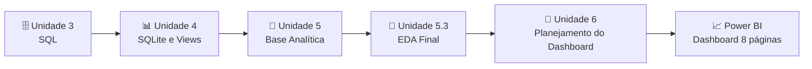

# 🚦📐 Unidade 6 – Planejamento Estratégico do Dashboard (Power BI)

Atividade do **Módulo 6 – Power BI e Dashboards Interativos** do programa **Aponti Academy**.

Antes de abrir o Power BI, esta atividade transforma o problema da **Polícia Rodoviária Federal (PRF)** em **perguntas analíticas visuais**, definindo o que o dashboard deve responder, com quais indicadores, filtros e visualizações.

> **Projeto:** Diagnóstico dos Acidentes Fatais nas Rodovias Federais (PRF 2025)
> **Autor:** Gustavo Henrique de Souza Silva
> **Data:** 21/09/2026
> **Formato:** Individual · uma folha por projeto

---

## 🎯 Objetivo

Elaborar o **Planejamento Estratégico do Dashboard**, preenchendo:

* 9 blocos de planejamento (contexto, objetivo, perguntas, dados, indicadores, entregas, público, riscos e próximos passos);
* 1 **matriz de 8 perguntas analíticas**, cada uma com página, indicador principal, filtros e visualização provável.

Todas as perguntas estão conectadas à variável-alvo `acidente_fatal` e aos achados das Unidades 3 a 5.3.

---

## 📂 Conteúdo da Pasta

| Arquivo | Descrição |
| --- | --- |
| `Planejamento_Estrategico_Dashboard_PRF.docx` | Planejamento completo em Word (editável) |
| `Planejamento_Estrategico_Dashboard_PRF.pdf` | Versão em PDF (4 páginas) para entrega |
| `README.md` | Este documento |

---

## 📌 Contexto do Problema

Em 2025, as rodovias federais registraram **72.529 acidentes** (base Datatran/PRF):

| Indicador | Valor |
| --- | --- |
| Acidentes com ao menos uma vítima fatal | **5.210** |
| Taxa de letalidade global | **7,18%** |
| Total de mortos | **6.043** |

Falta uma visão consolidada e visual dos fatores (via, causa, geografia e tempo) associados a esses acidentes fatais, o que dificulta priorizar ações de fiscalização e engenharia viária.

**Quem é afetado:** usuários das rodovias federais, PRF, órgãos de segurança viária e gestores públicos de trânsito.

---

## 🧭 Objetivo e Decisão Apoiada

* **Objetivo:** converter os achados validados nas Unidades 3 a 5.3 (SQL e Python/EDA) em um dashboard interativo que responda *"quais fatores estão associados a acidentes com vítimas fatais nas rodovias federais?"*.
* **Decisão apoiada:** priorizar trechos, estados e condições (tipo de pista, turno, causa) para fiscalização e investimento em infraestrutura, com base em **risco proporcional**, e não apenas em volume de ocorrências.

---

## ❓ Perguntas Analíticas

| # | Pergunta |
| --- | --- |
| P1 | Qual o volume total de acidentes e a taxa geral de letalidade? |
| P2 | Como evolui o % de acidentes fatais ao longo dos meses de 2025? |
| P3 | Quais UF concentram mais acidentes e quais têm maior letalidade proporcional? |
| P4 | Em quais dias da semana e turnos os acidentes fatais são proporcionalmente mais frequentes? |
| P5 | Quais causas e tipos de acidente têm maior taxa de letalidade? |
| P6 | Que tipo de pista e condição climática estão associados a maior risco de morte? |
| P7 | Quais combinações de fatores (ex.: pista × fase do dia) mais elevam a chance de acidente fatal? |
| P8 | Quais segmentos (UF, causa, pista) têm risco muito acima da média nacional (7,18%)? |

---

## 🗃️ Dados Utilizados

| Código | Fonte | Situação |
| --- | --- | --- |
| D1 | `base_analitica_prf_2025.csv` (Unidade 5) | 72.529 registros, tratada, com `acidente_fatal` já derivada |
| D2 | Views SQLite (Unidade 4): `vw_indicadores_mensais` e `vw_indicadores_uf_br` | Validadas, com indicadores agregados |
| D3 | Resultados de EDA em Python (Unidades 5.2 e 5.3) | Rankings, cruzamentos e correlações usados como **gabarito** para validar o Power BI |

---

## 📊 Indicadores Definidos

| Código | Indicador | Cálculo / Descrição |
| --- | --- | --- |
| I1 | % de acidentes fatais | (acidentes com `acidente_fatal = 1` ÷ total de registros) × 100, por UF, causa, pista, clima, turno e mês |
| I2 | Taxa de letalidade por 100 acidentes | Comparação padronizada entre segmentos de tamanhos diferentes |
| I3 | Índice de gravidade e total de vítimas | Combinação ponderada de mortos, feridos graves e leves, e total de vítimas por acidente |

---

## 🗺️ Matriz de Perguntas × Dashboard

| # | Página | Indicador principal | Filtros | Visualização provável |
| --- | --- | --- | --- | --- |
| 1 | Visão Geral | Total de acidentes; % fatais (taxa global) | Período (mês) | Cartões de KPI |
| 2 | Acidentes Fatais | % de acidentes fatais por mês | Mês, UF | Gráfico de linha (série temporal) |
| 3 | Análise Geográfica | Total de acidentes e % fatais por UF | UF, BR | Mapa/barras + tabela volume × % |
| 4 | Análise Temporal | % fatais por dia da semana e turno | Dia da semana, turno, fim de semana | Gráfico de barras |
| 5 | Causas e Tipos | % fatais por causa e tipo de acidente | Causa, tipo de acidente | Ranking de barras horizontais |
| 6 | Fatores Associados | % fatais por tipo de pista e clima | Tipo de pista, clima, fase do dia | Barras comparativas |
| 7 | Cruzamentos com o Alvo | % fatais por combinação de 2 fatores | Tipo de pista, fase do dia, causa | Matriz de calor (heatmap) |
| 8 | Segmentos Críticos | Desvio do % fatal do segmento vs. taxa global | UF, causa, pista, volume mínimo | Tabela de destaque / cartões de alerta |

---

## 📦 Entregas Previstas

* **E1:** arquivo `.pbix` com a base tratada importada e modelo de dados documentado.
* **E2:** medidas DAX documentadas, organizadas por pasta/tabela (uma para cada indicador).
* **E3:** dashboard com **8 páginas temáticas**, cada uma com uma mensagem-chave.

---

## 👥 Público e Uso

* **Gestores da PRF e de órgãos de trânsito:** priorização de fiscalização e obras em trechos e horários de maior risco.
* **Avaliação acadêmica:** validação da aplicação do roteiro de EDA em uma ferramenta de BI.
* **Autor:** evidência de portfólio em Data Analytics.

---

## ⚠️ Riscos e Premissas

* **Risco – volume × risco:** uma UF com mais acidentes pode parecer "mais perigosa". *Mitigação:* exibir volume e % lado a lado em todas as páginas.
* **Risco – correlação × causalidade:** `mortos` tem correlação de 0,88 com `acidente_fatal` por definição, não por descoberta.
* **Premissa:** a base de 2025 é representativa do padrão de acidentalidade das rodovias federais.
* **Atenção:** categorias "ignorado" foram mantidas no volume, mas podem diluir taxas por categoria.

---

## ✅ Próximos Passos

| Etapa | Responsável | Prazo |
| --- | --- | --- |
| Importar e validar a base tratada no Power Query | Gustavo | 2 dias |
| Criar e documentar as medidas DAX dos indicadores | Gustavo | 3 dias |
| Montar as 8 páginas com segmentadores e validar contra os resultados de Python/SQL | Gustavo | 5 dias |

---

## ☑️ Checklist de Revisão

- [x] Pergunta ligada ao objetivo
- [x] Indicador responde a uma pergunta
- [x] Dado com fonte definida
- [x] Entrega com público definido

---

## 🔗 Relação com as Unidades Anteriores

