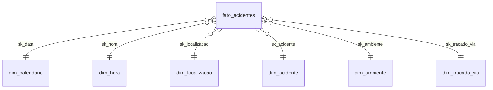
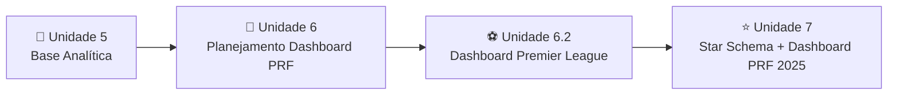

# 🚦⭐ Unidade 7 – Star Schema e Dashboard de Acidentes PRF 2025 (Power BI)

Atividade da **Unidade 7** do programa **Aponti Academy**.

O projeto parte de um **planejamento estratégico** (9 blocos + matriz de perguntas analíticas), constrói um **modelo dimensional Star Schema** (1 fato + 6 dimensões) a partir da base `datatran` da **Polícia Rodoviária Federal (PRF) – 2025** e entrega um **dashboard interativo em Power BI**.

> **Projeto:** Dashboard de Acidentes PRF 2025 (Star Schema + Power BI)
> **Autor:** Gustavo Henrique de Souza Silva
> **Professor:** Danilo Cavalcanti
> **Data:** 17/10/2026

---

## 📂 Conteúdo da Pasta

```
atv_unidade_7/
├── README.md
├── Planejamento_Estrategico_Acidentes_PRF_2025.docx
├── dashboard_prf_aponti_2025.pbix
└── star_schema_csv/
    ├── fato_acidentes.csv
    ├── dim_calendario.csv
    ├── dim_hora.csv
    ├── dim_localizacao.csv
    ├── dim_acidente.csv
    ├── dim_ambiente.csv
    └── dim_tracado_via.csv
```

| Arquivo | Descrição |
| --- | --- |
| `Planejamento_Estrategico_Acidentes_PRF_2025.docx` | Planejamento Estratégico de Analytics (9 blocos + matriz de perguntas) |
| `dashboard_prf_aponti_2025.pbix` | Dashboard em Power BI com modelo de dados e 6 páginas |
| `star_schema_csv/` | 7 CSVs do modelo Star Schema (separador `;`, decimal `,`, UTF-8 com BOM) |

---

## 📌 Contexto e Problema

Em 2025, a PRF registrou **72.529 acidentes** em rodovias federais, com **6.043 mortos** e **83.550 feridos**.

Falta uma visão única de **quando, onde e por que** os acidentes graves acontecem.

* **Afetados:** condutores, passageiros, pedestres e gestores de segurança viária.
* **Objetivo:** construir um dashboard que mostre volume e gravidade dos acidentes de 2025.
* **Decisão apoiada:** onde, quando e sobre quais causas priorizar fiscalização e prevenção, com foco em **reduzir mortes (letalidade)**, não só o número de ocorrências.

---

## ❓ Perguntas Analíticas

| # | Pergunta |
| --- | --- |
| P1 | Como evoluem acidentes e mortes no ano? |
| P2 | Quais horários concentram mais mortes? |
| P3 | Quais UFs, BRs e cidades têm mais acidentes? |
| P4 | Quais causas e tipos mais matam? |
| P5 | Clima, pista e traçado afetam a gravidade? |
| P6 | Onde a letalidade é maior (região/UF)? |
| P7 | Qual o peso de feridos e fatais no total? |

---

## ⭐ Modelo Star Schema



### Tabela Fato

| Tabela | Linhas | Grão | Principais colunas |
| --- | --- | --- | --- |
| `fato_acidentes` | 72.529 | 1 linha por acidente | `id_acidente`, 6 chaves `sk_`, `km`, `latitude`, `longitude`, `qtd_acidentes`, `pessoas`, `mortos`, `feridos_leves`, `feridos_graves`, `feridos`, `ilesos`, `ignorados`, `veiculos` |

### Dimensões

| Tabela | Linhas | Chave | Atributos |
| --- | --- | --- | --- |
| `dim_calendario` | 365 | `sk_data` | data, ano, trimestre, mês, nome do mês, dia, dia da semana, fim de semana, semana do ano |
| `dim_hora` | 24 | `sk_hora` | hora, hora em texto, período (ex.: Madrugada 00h-05h) |
| `dim_localizacao` | 2.482 | `sk_localizacao` | região, UF, município, BR |
| `dim_acidente` | 1.498 | `sk_acidente` | causa, tipo e classificação do acidente |
| `dim_ambiente` | 383 | `sk_ambiente` | fase do dia, sentido da via, condição meteorológica, tipo de pista, uso do solo |
| `dim_tracado_via` | 605 | `sk_tracado_via` | traçado da via + indicadores `tem_*` (reta, curva, aclive, declive, interseção, ponte, viaduto, túnel, rotatória, retorno, obras, desvio) |

### ✅ Validações Realizadas

| Verificação | Resultado |
| --- | --- |
| `id_acidente` único | 72.529 valores únicos para 72.529 linhas |
| Integridade referencial | Nenhuma chave `sk_` órfã na fato, em nenhuma das 6 dimensões |
| Total de mortos | 6.043 |
| Total de feridos (leves 63.532 + graves 20.018) | 83.550 |
| Total de veículos | 144.922 |
| Total de pessoas | 188.346 |

---

## 📊 Indicadores

| Código | Indicador | Cálculo | Valor 2025 |
| --- | --- | --- | --- |
| I1 | Acidentes | Contagem de `id_acidente` (soma de `qtd_acidentes`) | 72.529 |
| I2 | Mortos e feridos graves | `SUM(mortos)` e `SUM(feridos_graves)` | 6.043 e 20.018 |
| I3 | Letalidade | mortos ÷ acidentes × 100 | 8,3 mortos por 100 acidentes |

> 📝 **Atenção:** nesta unidade a **letalidade** é medida em *mortos por 100 acidentes* (8,3). Na Unidade 6 o indicador era o **% de acidentes com ao menos uma vítima fatal** (7,18%). São métricas diferentes, pois um acidente pode ter mais de uma morte.

---

## 🗺️ Matriz de Perguntas × Dashboard (Planejado)

| # | Página / seção | Indicador principal | Filtros | Visualização provável |
| --- | --- | --- | --- | --- |
| 1 | Visão geral / Tempo | Acidentes e mortos por mês e dia da semana | Mês, trimestre, fim de semana | Colunas + linha (série mensal) |
| 2 | Tempo | Acidentes, mortos e letalidade por hora e fase do dia | Fase do dia, dia da semana | Colunas por hora; matriz (mapa de calor) dia × período |
| 3 | Localização | Acidentes e mortos por UF, BR e município | Região, UF, BR | Mapa (lat/long) + barras horizontais (top 10) |
| 4 | Causas e tipos | Mortos e % do total por causa e por tipo | Classificação, UF, período | Barras horizontais; treemap |
| 5 | Ambiente | Letalidade por clima, tipo de pista e traçado | Condição meteorológica, tipo de pista, uso do solo | Barras 100% empilhadas; matriz |
| 6 | Localização / Diagnóstico | Letalidade (mortos ÷ acidentes × 100) | Região, UF, período | Barras ordenadas + cartão KPI |
| 7 | Visão geral | % de acidentes por classificação; totais de pessoas, feridos e veículos | Período, UF | Rosca + cartões KPI |

---

## 📈 Dashboard Construído (`.pbix`)

O arquivo contém **6 páginas** (o planejamento previa 4):

| Página | Pergunta | Visuais |
| --- | --- | --- |
| `Apresentação` | Capa | Título, autor, data e professor |
| `Página 1` | P1 e P2 | Colunas de mortos e acidentes por mês; colunas de mortos por hora |
| `Página 2` | P2 | Linha de letalidade por hora; matriz "Mortos por dia da semana e período"; segmentadores de fase do dia e dia da semana |
| `Página 3` | P3 | Mapa "Acidentes por cidade" (acidentes e mortos) e mapa coroplético (feridos, veículos e pessoas); segmentadores de região, UF e BR |
| `Página 4` | P4 | Tabela "Quais causas e tipos mais matam" (mortos por causa do acidente) |
| `Página 5` | P5 | Tabela de letalidade por tipo de pista × traçado (aclive, curva, declive, interseção, reta, rotatória); colunas de acidentes por classificação e clima; matrizes de letalidade por pista × área urbana e por sentido × fase do dia; segmentadores de clima, pista e uso do solo |

### Medidas DAX Identificadas

`Total Acidentes` · `Total Mortos` · `Total Feridos` · `Total Veiculos` · `Total Pessoas` · `Letalidade` · `Let Aclive` · `Let Curva` · `Let Declive` · `Let Interseção` · `Let Reta` · `Let Rotatória`

### Colunas Calculadas Identificadas

* `dim_localizacao.cidade_uf` (usada nos mapas).

### 🔎 Cobertura das Perguntas

* **P6 (letalidade por região/UF)** e **P7 (distribuição por classificação, cartões de totais)** não têm um visual dedicado no layout do arquivo. A análise por região/UF é possível pelos segmentadores da `Página 3`, e a classificação aparece no gráfico de colunas da `Página 5`.
* O planejamento previa **treemap**, **rosca** e **barras 100% empilhadas**, que não aparecem no arquivo final.

---

## ⚠️ Riscos e Premissas

* Em **3.823 acidentes**, `pessoas` ≠ mortos + feridos + ilesos + ignorados (inconsistência da fonte).
* **1 acidente sem classificação**, marcado como "Não Informado".
* Não há dados de tráfego, portanto não é possível calcular taxa por km rodado.
* **Premissa:** cada linha do `datatran` é 1 acidente e a base de 2025 está completa (365 dias).

---

## 👥 Público e Uso

* **Gestores da PRF e de segurança viária:** planejamento mensal/trimestral de operações e campanhas educativas, decidindo onde, quando e contra quais causas agir primeiro.
* **Avaliação acadêmica:** Aponti Academy.

---

## ✅ Próximos Passos (Cronograma do Planejamento)

| Etapa | Responsável | Prazo |
| --- | --- | --- |
| Importar os 7 CSVs e criar relacionamentos `sk_` (1:*) | Equipe | 17/10 |
| Criar medidas DAX e as páginas do dashboard | Equipe | 17/10 |
| Revisar com o checklist e entregar na Aponti Academy | Equipe | 17/10 |

---

## 🔗 Relação com as Unidades Anteriores

